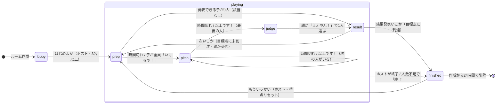

# 状態遷移図

ゲーム全体の段階（`rooms.status` と `rounds.phase` の組み合わせ）です。
遷移の可否は `src/lib/game/phase.ts` の `canTransition()` が判定し、ユニットテスト
（`src/lib/game/__tests__/phase.test.ts`）で確かめています。

## 補足

| 遷移 | 誰が起こすか | API |
|---|---|---|
| lobby → prep | ホスト | `/api/game/start` |
| prep → pitch | 誰でも（締め切り後）／最後に「いけるで！」を押した子 | `/api/phase/advance`・`/api/hand/ready` |
| pitch → pitch / judge | 誰でも（締め切り後）／発表者・親・ホスト | `/api/phase/advance`・`/api/pitch/end` |
| judge → result | 親（親が切断して60秒たったらホストも可） | `/api/judge` |
| result → prep / finished | ホスト・親 | `/api/round/next` |
| playing → finished | ホスト | `/api/game/end`・`/api/game/low-players` |
| finished → prep | ホスト | `/api/game/rematch` |

- 締め切り（`rounds.phase_ends_at`）はサーバー時刻で保存し、サーバーが時刻を確かめてから進めます。
  複数の端末が同時に `/api/phase/advance` を呼んでも、ルーム行のロックと `rounds.version` の確認により1回しか進みません。
- pitch 中の `phase_ends_at` は「いま発表している人」の締め切りです。発表者が変わるたびに更新されます。
- 発表の順番が来た時点で切断中の人は、スキップとして記録されます（カードは公開されません）。
